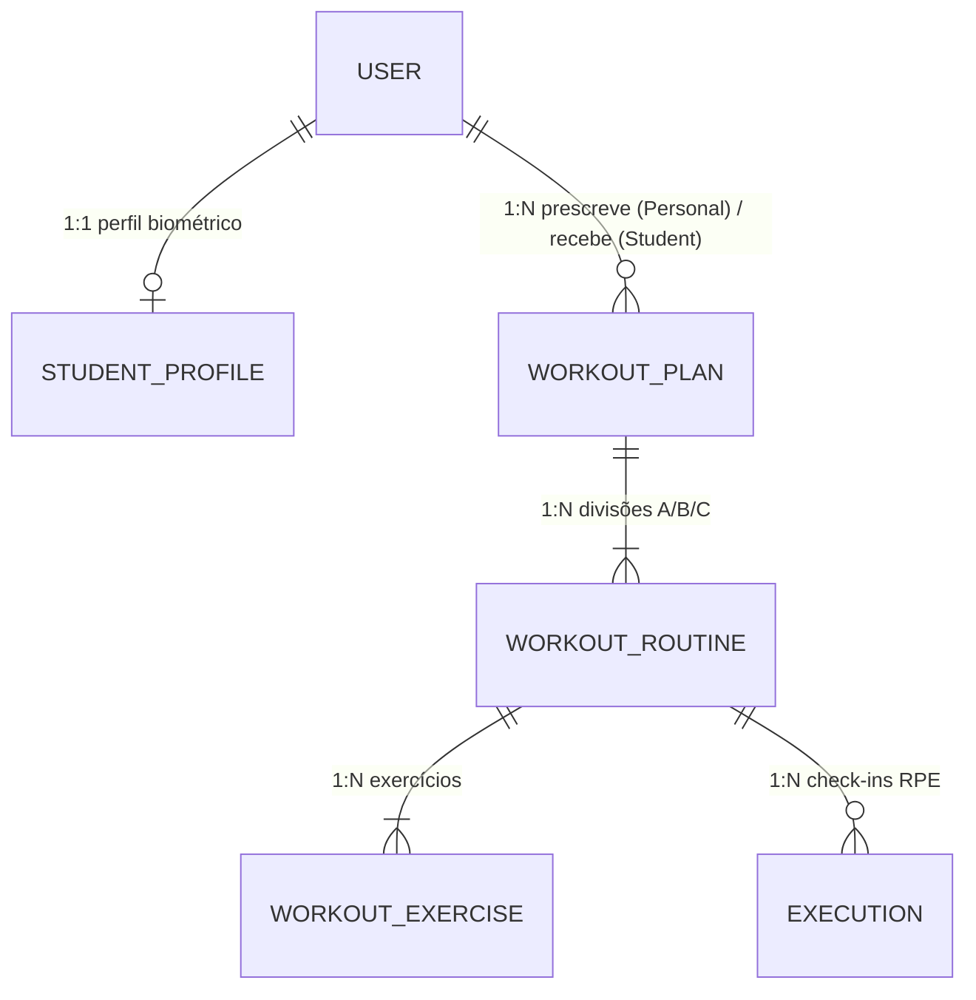

# 🏋️‍♂️ GymFlow API — Gestão de Treinos e Acompanhamento Físico (P2)

> **Disciplina:** Programação Web (2026.2) — Fatec Ribeirão Preto  
> **Metodologia:** API Design-First (Apidog) + Spec-Driven Development (SDD no Google Antigravity)  
> **Documentação Pública no Apidog:** https://3f9huyoq5b.apidog.io/readme-2508436m0

---

## 👥 1. Organização da Equipe

| Integrante | RA | Papel no Projeto SDD |
| :--- | :---: | :--- |
| **João Gabriel Cardoso** | `2840482421028` | `[Spec Auditor]` & `[Tech Lead]` — Arquitetura SDD (`SPEC.md`, `STYLEGUIDE.md`, `PLAN.md`) e Contratos Apidog |
| **Rodrigo de Azevedo Junior** | `2840482421044` | `[Backend Coder]` — Persistência ORM SQLAlchemy 2.0 + Segurança JWT/RBAC |
| **Thales de Oliveira Silva** | `2840482413031` | `[QA Engineer]` — Suíte Automatizada `pytest` + Painel de Demonstração |

---

## 🏛️ 2. Desenvolvimento com IA usando SDD (Spec-Driven Development)

O repositório contém toda a trilha de governança exigida pela metodologia SDD:
- **[`STYLEGUIDE.md`](STYLEGUIDE.md):** Constituição Técnica definindo stack (FastAPI, Pydantic v2, SQLAlchemy 2.0, PyJWT, RFC 9457).
- **[`AGENTS.md`](AGENTS.md) & [`.agents/skills/sdd-apidog-workflow/SKILL.md`](.agents/skills/sdd-apidog-workflow/SKILL.md):** Regras de atuação das personas `[Spec Auditor]`, `[Tech Lead]`, `[Backend Coder]` e `[QA Engineer]`.
- **[`SPEC.md`](SPEC.md):** Especificação de negócio, matriz RBAC (`PERSONAL` vs. `STUDENT`) e mapeamento relacional.
- **[`PLAN.md`](PLAN.md):** Checklist sequencial das 6 fases de construção 100% concluído (`[x]`).
- **[`GymFlow API.apidog.json`](GymFlow%20API.apidog.json):** Contrato OpenAPI completo com os 26 Data Schemas e 18 rotas.

---

## 🗄️ 3. Mapeamento Objeto-Relacional (SQLAlchemy 2.0 ORM)

Implementado em [`src/api/models.py`](src/api/models.py) e [`src/api/database.py`](src/api/database.py) com `DeclarativeBase`, `Mapped`, `mapped_column`, `relationship` e carregamento eager via **`selectinload`** (prevenindo o problema de queries **N+1**):



---

## 🔐 4. Autenticação JWT (`HS256`) e Controle de Acesso RBAC

Implementado em [`src/api/security.py`](src/api/security.py) e [`src/api/exceptions.py`](src/api/exceptions.py):
- **Credenciais de Seed Inicial:**
  - **Personal Trainer (`role: PERSONAL`):** `carlos@gymflow.dev` / `Personal@2026`
  - **Aluno (`role: STUDENT`):** `rodrigo@gymflow.dev` / `Aluno@2026`
- **Padronização RFC 9457 (Problem Details):** Todos os erros `400`, `401`, `403`, `404`, `409` e `422` retornam o schema canônico `ApiError` (`type`, `title`, `status`, `detail`, `instance`, `invalidParams`).

---

## 🚀 5. Conteúdos Extras Implementados pela Equipe

1. **Painel Web Interativo Ao Vivo (`GET /` em `http://localhost:8000/`):**
   - Interface visual integrada ao FastAPI que permite autenticar com 1 clique como `PERSONAL` ou `STUDENT`, inspecionar o token JWT, visualizar fichas de treino com exercícios aninhados (`selectinload`), registrar check-in de treino na **Escala RPE Borg (1 a 10)** e simular ao vivo o bloqueio **RBAC `403 Forbidden` (RFC 9457)**.
2. **Endpoint de Analytics Biométrico & Engajamento (`GET /api/v1/students/{studentId}/analytics`):**
   - Calcula automaticamente o **IMC (`bmi`)**, a **Classificação OMS do IMC**, o total de fichas ativas, minutos totais treinados e a **média de intensidade RPE Borg** do aluno.

---

## 🧪 6. Como Executar a Demonstração Funcional e os Testes

### 1. Instalar dependências
```bash
pip install -r src/api/requirements.txt
```

### 2. Executar a suíte de testes automatizados (`pytest`)
```bash
pytest -v
```

### 3. Iniciar o servidor para a Demonstração Funcional
```bash
uvicorn src.api.main:app --reload
```
- **Painel Visual Interativo (Live Demo):** http://localhost:8000/
- **Documentação Interativa Swagger UI:** http://localhost:8000/docs
